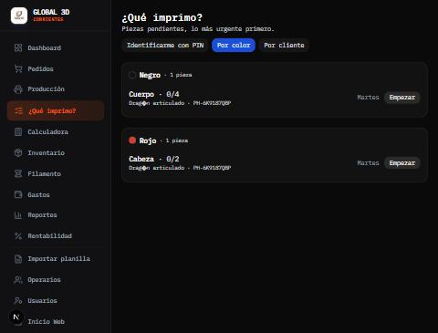
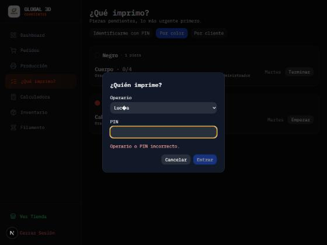
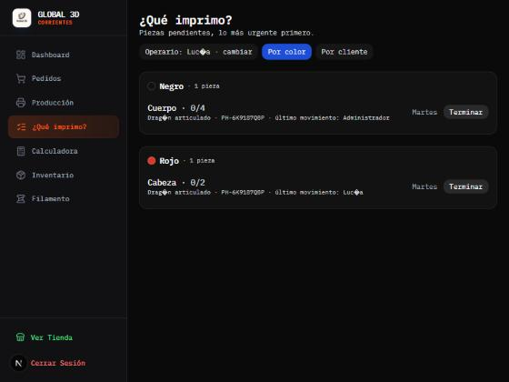
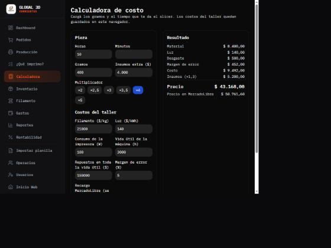

# Manual del taller — PrintHub3D (V5)

> Las capturas son de un **entorno de prueba local** con datos cargados a mano para probar; no son de un cliente real. El **video de 5 minutos de la cola** no está grabado (ver «Falta»).

## 1. El día a día en 5 pasos
1. **Cargar productos con sus partes** (Inventario → Nuevo producto → «Partes a imprimir»): por ejemplo *Cabeza (rojo) ×1* y *Cuerpo (negro) ×2*.
2. **Crear el pedido** (Pedidos → Nuevo): cliente, producto, fecha de entrega. Podés sumar un **link de referencia** y **subir fotos o modelos 3D (.stl / .3mf, hasta 50 MB)**. Las piezas de la cola se generan solas.
3. **Mirar «¿Qué imprimo?»**: las piezas pendientes, agrupadas por color (para cambiar el carrete menos veces) o por cliente, lo más urgente primero.
4. **Imprimir y avanzar**: *Empezar* → *Terminar*. Si el taller tiene operarios, te pide tu **PIN** (una sola vez por turno).
5. **Entregar**: cuando terminaron todas las piezas, pasá el pedido a «listo» y luego a «entregado» desde Pedidos (hoy el estado del pedido se cambia a mano; no cambia solo al terminar las piezas). El cliente ve el estado con su código de seguimiento.

## 2. Operarios y PIN
- El administrador los crea en **Operarios** (nombre + PIN de 4 a 8 dígitos; no se aceptan 0000, 1234, 9876…).
- Con 5 PIN incorrectos seguidos el operario **se bloquea 15 minutos**; el administrador puede cambiarle el PIN para destrabarlo.
- Cada avance queda registrado con **quién lo hizo y cuándo**; se ve en la cola («último movimiento»).
- El administrador no necesita PIN, pero queda registrado como administrador.

## 3. Calculadora de costo
En **Calculadora** cargás gramos y tiempo del slicer; los costos del taller (filamento, luz, repuestos…) quedan guardados en ese navegador. Da el precio con el multiplicador que elijas y el precio para MercadoLibre. La fila «Portallaves grande» de la planilla da exactamente **$43.168** (y $50.761,60 en MercadoLibre).

## 4. Seguridad para el dueño
- Activá la **verificación en dos pasos** de tu cuenta de administrador (app de autenticación).
- **Cerrar sesión en todos los dispositivos** si perdés un teléfono o una compu.
- Contraseñas de administrador y personal: **12 caracteres o más**.
- Los datos de un cliente se pueden **exportar o borrar a pedido** (ver `docs/PRIVACIDAD-BORRADOR.md`).

## 5. Qué hago si se cae
Ver `docs/MONITOREO.md` (sección 4): primero `/api/health`, después los logs del servicio, después el último deploy.

## 6. Checklist de traspaso al cliente
- [ ] Dominio a nombre del cliente
- [ ] Cuentas de Atlas, Render/Vercel, Mercado Pago, Twilio a nombre del cliente (el proveedor queda como colaborador)
- [ ] Repositorio entregado o con acceso de lectura, según el contrato
- [ ] Administrador del cliente creado, con 2FA activo; la clave temporal del proveedor eliminada
- [ ] Operarios cargados con PIN propio
- [ ] `scripts/smoke-test.mjs` en «Todo en orden»
- [ ] Monitores de uptime creados y avisando al dueño
- [ ] Restauración de backup probada y anotada (`docs/BACKUP-Y-RESTAURACION.md`)
- [ ] Contacto de `security.txt` completado
- [ ] Contrato firmado (alcance del soporte, qué NO incluye, datos del cliente suyos) — **lo redacta un abogado**

## Falta
- Video de 5 minutos del flujo de la cola (👤: se graba con la instancia del cliente real).
- Este manual en PDF corto: se exporta desde este archivo cuando tenga las capturas del cliente real.
